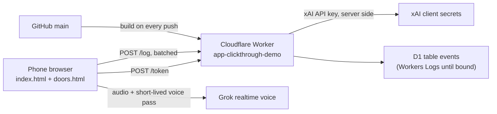

# TPACTION clickthrough demo

A phone web app demo of the TPACTION redesign for Turning Point Action volunteers: sign-in, Home, People, Chase
(doors, calls, texts, mail), Events, Me, search and notifications, a door-to-door canvassing map, a Grok voice
assistant that can drive the app, and an activity log. **All voters, addresses, notes and numbers are example data.**

- **Live:** https://app-clickthrough-demo.falling-dawn-6bfc.workers.dev/
- **Every change, version by version:** [CHANGELOG.md](CHANGELOG.md)

On a phone it runs full screen (add it to the home screen to use it like an app); on a desktop it shows inside a
phone frame. It follows the system light/dark setting; Me › Dark mode overrides it.

## Versions

| Address | Files | What it is |
|---|---|---|
| `/` | `index.html`, `doors.html` | **Main app (V4):** sign-in on every launch, Figma revisions (Montserrat, Superfeed brand colors), Canvassing V3 map, voice assistant with app navigation |
| `/v3/` | `v3/` | Previous main version: sign-in, no voice navigation |
| `/v2/` | `v2/` | Figma revisions with the earlier navy canvassing map |
| `/v1/` | `v1/` | The original design with the earlier canvassing map |

Each version folder has its own copy of the map, so changing the main app never changes an older version.
All versions share the Worker and the activity log; the `app_open` event carries `v4`, `v3`, `v2` or `v1`.

## Repository layout

| Path | What it is |
|---|---|
| `index.html` | The app in one page: screens, sign-in, voice assistant, activity logger, navigation API (`window.tpaApp`) |
| `doors.html` | The canvassing map (map/list, voter sheet, stages, skips, voter record, contact log), opened full screen from Chase → Doors |
| `worker/token-worker.js` | Cloudflare Worker: `POST /token` (Grok voice pass) and `POST /log` (activity log); serves the pages |
| `wrangler.jsonc` | Deploys the pages and the Worker together; used by Cloudflare's GitHub build |
| `worker/wrangler.toml` | Alternative: deploys only the Worker endpoints |
| `.assetsignore` | Keeps the Worker code, config, README and change log off the public site |
| `CHANGELOG.md` | Every change with its commit |

## How it fits together



## Sign-in

Every launch opens a sign in / sign up screen (for the demo it always appears and starts empty). Required:
first name, last name, mobile phone (formatted as you type; a leading 1 is accepted) and a 5-digit ZIP code,
with inline errors. Signing in puts the person's initials in the header, their name on Me, and their first name in
Grok's greeting. There is no password or text-message code: nothing is checked against a real account.

## Grok voice assistant

The red mic button opens a live voice conversation. The page never holds an xAI key: it asks the Worker for a
short-lived voice pass (`POST /token`), then connects to `wss://api.x.ai/v1/realtime` with it.

- **Billing guard:** the session closes after 8 seconds of quiet (`IDLE_MS` in `index.html`). The clock pauses
  while the person speaks, while Grok replies or plays audio, and while a tool is running. Tapping the orb reconnects.
- **Briefing:** `INSTRUCTIONS` in `index.html` holds Grok's example data and rules, including: never name a voter
  or address without opening them on the map first.
- **Tools** (sent in the second `session.update`, so the main session settings still apply if tools are refused):

| Tool | What it does |
|---|---|
| `save_name` | Stores a first name Grok was told (sign-in normally provides it) |
| `go_to_screen` | Opens any screen or tab (Home For you / Feeds / Team, People Match / Connect, Chase Doors / Calls / Texts / Mail, Events, event detail, recap, Me, Search, Notifications) |
| `open_walk_list` | Opens a walk list on the map or list; `last_used` is remembered per device (`localStorage` key `tpa-last-walk`) |
| `show_next_door` | Picks the next door (not worked today, unreturned ballots first, then closest; moves to the next campaign when a list is done) and singles the voter out on the map |
| `open_voter` | Finds a voter by name across the walk lists and singles them out |
| `close_walk_list` | Leaves the map, back to Chase → Doors |
| `open_campaign` | Opens any door, call, text or postcard campaign (rows that would claim or order something are only shown) |
| `find_in_app` | Finds feed posts, articles, videos, events, notifications, contacts, team members, text conversations, campaigns or activity by keywords, then shows and highlights the match |

Each tool returns what is now on screen (for a door: name, address, stage, ballot flags, household, last note),
and Grok describes it. While Grok navigates, the voice panel shrinks to a floating red orb; tapping it brings the
panel back.

**App ↔ map protocol.** Tools call `window.tpaApp` in `index.html`. For walk-list details it posts
`{source:'tpa-app', op, req}` to the map frame (`op`: `summary`, `set_view`, `next_door`, `open_voter`); the map
answers `{source:'tpa-doors', type:'reply', req, data}`. The map also sends `tap`, `result` and `close` messages,
which the app logs or acts on.

**Singled-out voter.** On the map, every other door fades, the voter's pin grows and pulses, and a "Go here next"
card offers Open (voter sheet) and Directions (Google Maps to the address). The map's own DIRECTIONS button also
goes there. Tapping another door or ✕ ends it.

## Canvassing map

`doors.html` is the "TPACTION Canvassing V3" design. The app opens it as `doors.html?c=<campaign>`:
`vnm` (Voters Near Me), `maryvale3` (Maryvale — Turf 3) or `estrella9` (Estrella Village — Turf 9). Each
campaign's example voters, distances, ballot flags, notes, header, street names and town/district fields are in
the `CAMPAIGNS` block near the end of the file. Opened without `?c`, it shows the design's original sample turf.

Changes made for the app, all in the "app hook" blocks: the header back button returns to the app, the per-campaign
data, the request/reply bridge and single-out mode, activity logging, and, when embedded, hiding the mockup's
sample status bar (the `in-app` class) and moving the layout up to close the gap.

## Activity log

The app batches events to `POST /log` (as `text/plain`, so it also works as a beacon while the page closes).

| Field | Meaning |
|---|---|
| `ts` | When it happened (ISO time from the device) |
| `received` | When the Worker received it |
| `visitor` | Per-device ID (`localStorage`) |
| `session` | Per-visit ID (`sessionStorage`); links events from before sign-in to the person |
| `user_id` | **Primary user ID:** the signed-in phone number as `+1XXXXXXXXXX`, on every event after sign-in |
| `name` | First name, after sign-in |
| `type` | Event type, below |
| `detail` | What was tapped, said or shown |
| `screen` | Screen at the time (`doors` while on the map) |
| `country` | From Cloudflare |

Event types: `app_open`, `app_close`, `sign_in` (full name, ZIP, phone), `name_given`, `screen`, `tap`,
`doors_result` (outcomes on the map, e.g. "Attempt 1 logged"), `voice_start`, `voice_connected`, `voice_paused`,
`voice_end`, `voice_error`, `voice_action` (each Grok tool call), `user_said`, `grok_said`.

Events go to the D1 database bound as `LOGS_DB` (table `events`, created on first use). **Not bound yet:** until
it is, the Worker writes each event to Workers Logs (Worker → Observability → search `tpa_event`). To read D1:
Cloudflare dashboard → Storage & databases → D1 → the database → Console, e.g.
`SELECT ts, user_id, name, type, detail, screen FROM events ORDER BY id DESC LIMIT 200;`

This log holds personal data: testers' names, phone numbers, ZIP codes and voice conversations. The sign-in and
voice screens say so. xAI keeps API traffic for 30 days.

## Hosting and configuration

One Cloudflare Worker, `app-clickthrough-demo`, serves the pages and both endpoints. Cloudflare's GitHub build
redeploys it on every push to `main` (deploy command `npx wrangler deploy`, root `/`); there is no separate publish
step.

| Setting | Where | Notes |
|---|---|---|
| `XAI_API_KEY` | Worker → Settings → Runtime variables and secrets, as a **secret** | A Grok Inference key from xAI (starts with `xai-`) |
| `ALLOWED_ORIGINS` | Same place, optional | Only for hosting the pages on another address too; the Worker's own address is always allowed |
| `LOGS_DB` | `wrangler.jsonc` `d1_databases`, with the database's ID | Not set up yet |
| `TOKEN_LIMITER` | `wrangler.jsonc` rate-limit binding, optional | Per-IP limit on voice passes |
| `TOKEN_URL`, `LOG_URL` | Top of the voice and logger scripts in `index.html` | Point at the Worker; change only if it moves |

`wrangler.jsonc` sets `keep_vars: true`, so settings made in the dashboard survive deploys.

## Testing locally

```bash
npx wrangler dev --var XAI_API_KEY:anything   # serves the app and the Worker on http://localhost:8787
```

Add a `d1_databases` entry to `wrangler.jsonc` to test the activity log with a local database, and read it with
`npx wrangler d1 execute <name> --local --command "SELECT * FROM events"`. Voice needs a real xAI key and HTTPS (or
`localhost`) for the microphone.

## Open items

- Create the D1 database for the activity log and bind it as `LOGS_DB`.
- Add the Turning Point Action logo to the header square (still a placeholder mark).
- Add a rate limit or access control before sharing the link widely: anyone with it can start a billed voice session.
- Design calls: contrast of the aqua `#9AFCFD` active tab and yellow `#F3B85C` text; the final Figma call/message icons.
